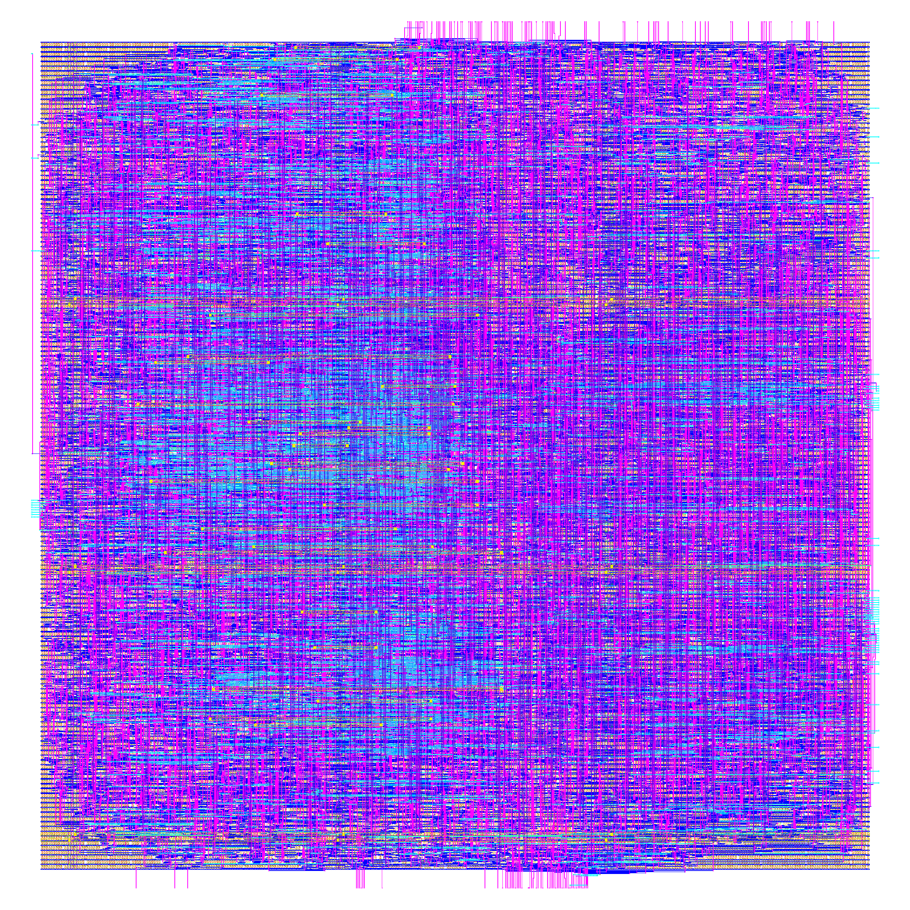
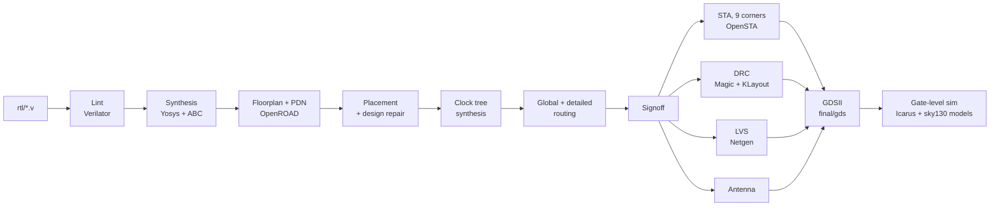
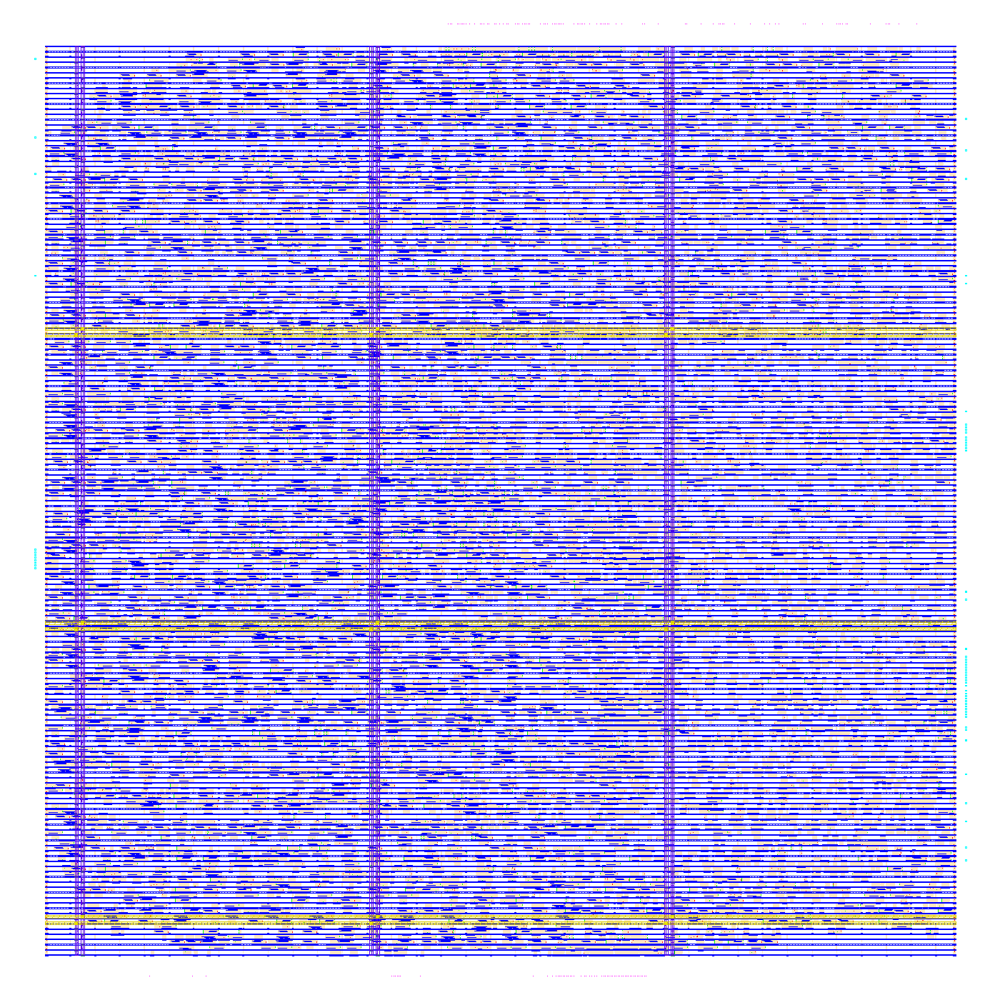
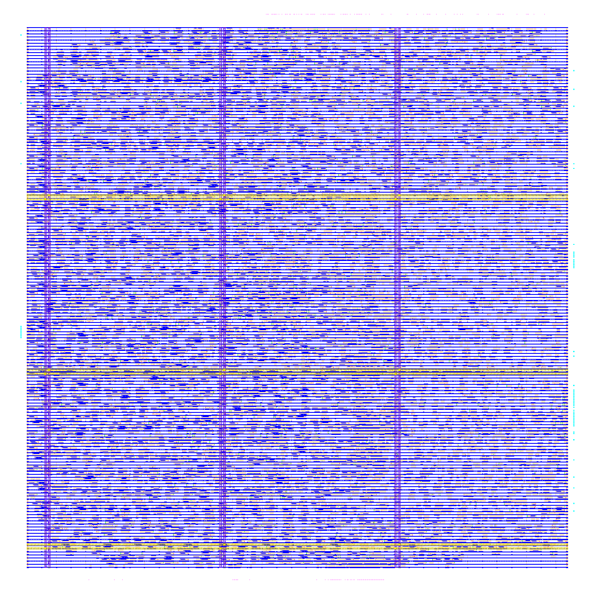
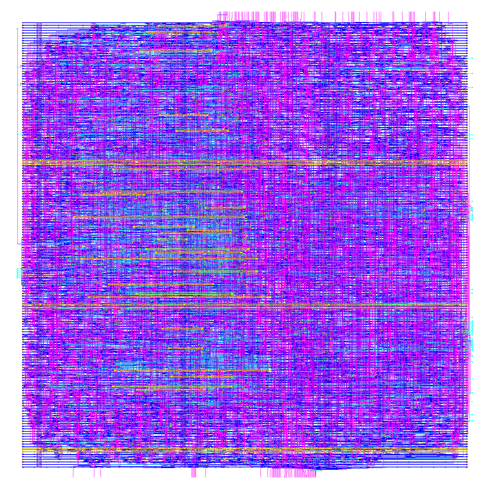
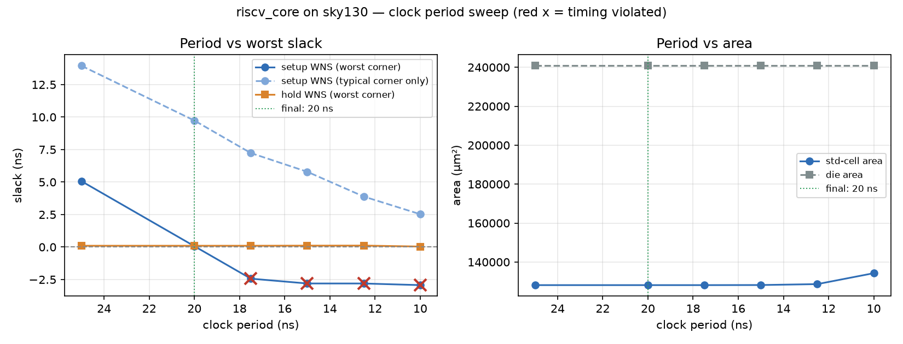

# RV32I 5-stage CPU core: RTL → GDSII on SkyWater sky130

A 5-stage pipelined RISC-V (RV32I) CPU core taken from Verilog RTL to a **signed-off GDSII layout** with the
open-source **LibreLane** flow (the successor of OpenLane 2) and the **SkyWater sky130** 130 nm PDK.
Includes gate-level simulation of the final netlist, a clock-period sweep, and documented timing, area
and power results.

**Final design: 20 ns clock (50 MHz).**

- Setup and hold met in all 9 signoff corners.
- 0 DRC, 0 LVS and 0 antenna errors.
- 0.24 mm² die, 15.6 k standard cells, ≈ 8.3 mW (estimate).

<p align="center">
  <br>
  <em>Final layout, 485 × 496 µm (KLayout; well, implant and marker layers hidden)</em>
</p>

## Overview

- **Core:** `rtl/riscv_core.v` is the CPU only.
  - Instruction and data memories are reached through ports (`imem_*`, `dmem_*` with byte enables).
  - The 32×32 register file stays inside.
  - Synchronous reset, no simulation-only constructs.
  - Cycle-for-cycle identical to the original memory-integrated design, kept in `ref/`.
- **Verification:**
  - RTL: 7 directed programs plus random programs, checked against a Python RV32I golden model
    (register-write trace, registers, memory, retired-instruction count).
  - Post-route netlist: the same checks at gate level with the sky130 cell models (57/57).
- **Physical design:** LibreLane 3.0.17 Classic flow (Yosys, OpenROAD, Magic, KLayout, Netgen) with
  sky130A / `sky130_fd_sc_hd`. Configuration in `flow/config.json`.
- **Exploration:** 18 documented iterations (`docs/iteration_log.md`) and a clock sweep from 25 to 10 ns.

## Flow



| Floorplan | Placement | Clock tree | Routing |
|---|---|---|---|
|  |  |  |  |

## Results

### Final PPA (20 ns)

| Metric | Value |
|---|---|
| Clock period / frequency | **20 ns / 50 MHz** |
| Setup WNS (worst of 9 corners, `max_ss_100C_1v60`) | **+0.066 ns** (TNS 0) |
| Hold WNS (worst of 9 corners, `max_ff_n40C_1v95`) | **+0.099 ns** (TNS 0) |
| Setup WNS, typical corner | +9.73 ns |
| Die | 485.36 × 496.08 µm = **240,777 µm² (0.241 mm²)** |
| Standard-cell area (logic) | 128,135 µm² (0.128 mm²) |
| Core utilization | 57.1 % |
| Logic cells / flip-flops | 15,606 / 1,442 |
| Power (OpenSTA estimate, typical corner, default activity) | 8.29 mW |
| DRC (Magic / KLayout / router) | 0 / 0 / 0 |
| LVS (Netgen) | 0 errors, circuits match uniquely |
| Antenna | 0 violations (88 diodes inserted) |
| Gate-level simulation | 57 / 57 programs pass |

Full details: [`results/ppa_summary.md`](results/ppa_summary.md) (per-corner timing, power split,
cell-type breakdown) and [`final/reports/`](final/reports).

### Clock-period sweep



| Period | Freq | Setup WNS (worst corner) | Hold WNS | DRC / LVS / antenna | Result |
|---:|---:|---:|---:|---|---|
| 25 ns | 40 MHz | +5.066 ns | +0.099 ns | clean | met |
| **20 ns** | **50 MHz** | **+0.066 ns** | **+0.099 ns** | **clean** | **met (final)** |
| 17.5 ns | 57 MHz | −2.434 ns | +0.099 ns | clean | setup fails (ss) |
| 15 ns | 67 MHz | −2.804 ns | +0.107 ns | clean | setup fails (ss) |
| 12.5 ns | 80 MHz | −2.806 ns | +0.112 ns | clean | setup fails (ss) |
| 10 ns | 100 MHz | −2.931 ns | +0.036 ns | clean | setup fails (ss) |

Full table with cell count, area, power and design-rule counts: [`results/clock_sweep.md`](results/clock_sweep.md).

The typical corner still meets timing at 10 ns. Only the slow (ss, 100 °C, 1.60 V) corners fail
below 20 ns. The flow's timing repair works against a single corner (the typical one), so 20 ns is
the limit of this flow setup rather than a hard limit of the core (see `docs/iteration_log.md`, F17).

### What it took

The first 25 ns run failed setup by 5 ns in the slow corners. The fixes that mattered:

1. **Delay cells as buffers.** The resizer was using delay cells as ordinary buffers. Excluding them
   was worth +2.7 ns.
2. **Repair after routing.** Slew and timing repair are now re-run after global routing.
3. **Synthesis strategy.** Switched to delay-oriented synthesis (`DELAY 1`).
4. **RTL change.** A branch flush used to clear about 200 data flip-flops; now it clears only the
   pipeline's control bits. Behavior is identical (verified cycle by cycle), and it was worth +2.5 ns.
5. **Slew margin.** Raised to 50 %, because design repair only checks the typical corner. Slew
   violations went from 148 to 0 in the typical corner and from 3094 to 803 in the slow corner.

Every attempt, including the ones that didn't work, is in [`docs/iteration_log.md`](docs/iteration_log.md).

## Project structure

```
rtl/                 synthesizable core: riscv_core.v + alu, control, forwarding, hazard, imm_gen, regfile
ref/                 original design with on-chip memories (cpu_top.v, memories, tb) — A/B reference only
tb/                  tb_core_with_mem.v (core + behavioral memories, RTL and gate-level), unit tests
asm/                 test programs (RV32I assembly)
scripts/             assembler, golden model, test runner, flow / sweep / report / render scripts
flow/config.json     LibreLane configuration of the final design
examples/counter/    8-bit counter used to validate the installation (Phase 1)
results/             clock sweep, PPA summary, layout and stage images, gate-level and lint reports
final/               signoff views of the final run: GDS, LEF, Liberty, netlists, SDC, SPEF, DEF, reports
docs/iteration_log.md  every flow failure, its cause and the fix
NOTES.md             plain-language notes on the flow, timing, memories and checks
```

`flow/runs/` (≈ 1.3 GB per run) is not tracked; `make flow` regenerates it.

## Prerequisites

- **Simulation only** (Windows, Linux or macOS): Python 3.10+, Icarus Verilog (`iverilog`, `vvp`), GNU make.
  `pip install -r requirements.txt` for the sweep chart.
- **Physical design:**
  - Linux, or Windows 11 with WSL2 (tested on Ubuntu 24.04), 8 GB RAM.
  - About 6 GB of disk for the tools and the PDK, plus about 1.3 GB per flow run.
  - Nix and LibreLane 3.0.17, with the sky130A PDK (open_pdks `8afc8346…`, fetched by Ciel).
  - One command installs everything, following the official LibreLane WSL guide:

    ```bash
    bash scripts/setup_wsl.sh
    ```

    The script also works around Ciel's 5 s download timeout (`scripts/fetch_pdk.py`).
  - Run flows one at a time. A single run peaks at about 2.6 GB of RAM; two in parallel ran out of
    memory in an 8 GB WSL VM.
  - The project path must **not contain spaces**: Yosys splits such paths. If it does, bind-mount the
    project at a space-free path (a symlink is not enough):

    ```bash
    sudo bash scripts/wsl_mount.sh
    ```

    This mounts it at `/root/rgo`.

## How to reproduce

RTL simulation (works from Windows too):

```bash
make sim
```

```bash
make sim-ref
```

Physical design, inside WSL / Linux, from the project root (or `/root/rgo`):

```bash
make counter
```

```bash
make lint
```

```bash
make flow PERIOD=20
```

```bash
make sweep
```

```bash
make final RUN=flow/runs/p20
```

```bash
make gate
```

```bash
make render ppa
```

What each target does:

- `make counter`: Phase 1 installation check (8-bit counter to GDS).
- `make lint`: Verilator + Yosys checks → `results/lint_report.txt`.
- `make flow PERIOD=20`: final design → `flow/runs/p20` (about 30 min).
- `make sweep`: 6 runs one after another (about 3 h) → `results/clock_sweep.*`.
- `make final RUN=flow/runs/p20`: copies the signoff views and reports into `final/`.
- `make gate`: gate-level simulation of `final/netlist` (fibonacci, hazard_test).
- `make render ppa`: layout images and `results/ppa_summary.md`.

Open the layout in KLayout (it reads `.gds.gz` directly):

```bash
klayout final/gds/riscv_core.gds.gz
```

The flow is deterministic: rerunning 25 and 20 ns reproduced the earlier results to the last digit.

## Limitations

- **Core only.** No instruction or data memory on the die: both are reached through ports, and a real
  chip would add SRAM macros or external memory (see NOTES.md §5).
- **No pad ring.** This is a macro, not a packaged chip: I/O pins sit on the die edge, without I/O
  pads, ESD protection or a seal ring.
- **Not fabricated.** No silicon, no foundry signoff; "clean" means the checks run by this open flow.
- **Power is an estimate.** It comes from OpenSTA with default switching activity at the typical
  corner, not from a measurement or a simulation-based activity file.
- **Design-rule warnings remain.** All are against the flow's own targets: max-slew in the slow
  corners only, under the library's 1.5 ns limit, and 1 max-cap plus 25 max-fanout violations on the
  clock tree (`docs/iteration_log.md`).
- **20 ns is limited by the flow setup.** Timing repair targets a single (typical) corner. Slow-corner
  repair could likely go faster; not done.
- **Gate-level simulation is functional only.** It uses zero-delay cell models; timing is covered by
  STA, and there is no SDF back-annotated simulation. One of three injected single-gate faults was not
  caught by the 7 directed programs.
- **ISA scope.** RV32I without CSRs, interrupts or exceptions; ECALL/EBREAK halt the core.

## What I learned

_TODO: write a few sentences in your own words: what surprised you, what was hard, what you would do differently._

-
-
-

## License

MIT, see [LICENSE](LICENSE). The sky130 PDK, LibreLane and the EDA tools have their own licenses.
